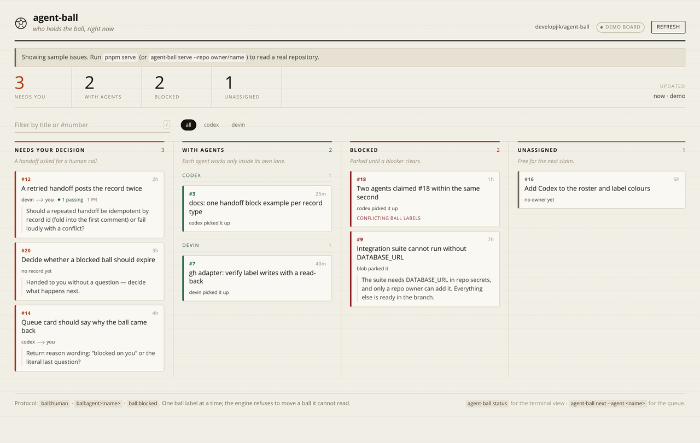
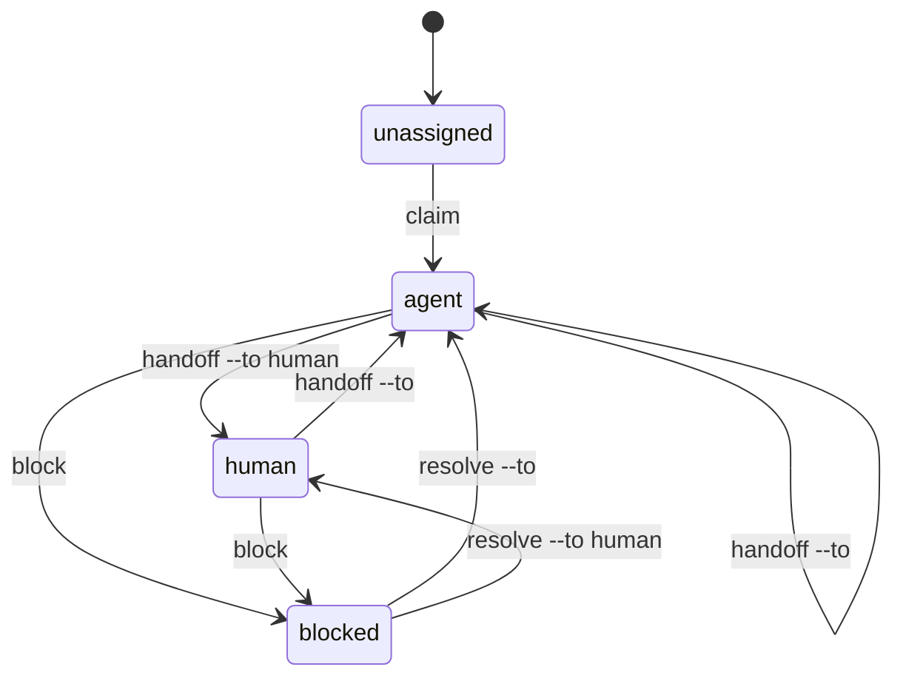
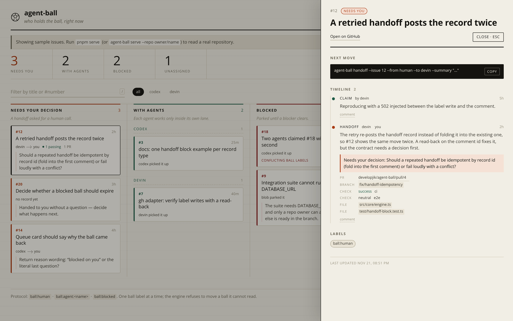

# agent-ball ⚽

[English](README.md) · 한국어

**공 하나, 주인 하나.** GitHub Issues 위에서 사람과 코딩 에이전트가 차례를 주고받습니다.

[](https://github.com/developjik/agent-ball/actions/workflows/ci.yml)

여러 에이전트 — Devin, Claude Code, Codex, Damon — 와 사람 한 명이 한 리포를 함께 씁니다. 누구 차례인지 규칙이 없으면 둘이 같은 이슈를 집고, 둘 다 브랜치를 밀어 올리고, 당신에게 닿았어야 할 핸드오프는 타임라인 속에 묻힙니다. `agent-ball`은 **이슈의 레이블을 누가 작업할 수 있는지에 대한 유일한 진실**로 만들고, 모든 이동을 증거가 붙은 코멘트로 남기며, 전체 큐를 5초 만에 읽을 수 있는 보드로 보여줍니다.



```text
agent-ball · developjik/agent-ball
8 open · 3 need you · 2 with agents · 2 blocked

NEEDS YOUR DECISION (3)
  #12  A retried handoff posts the record twice
      devin → you · 2h
      “Should a repeated handoff be idempotent by record id…?
AGENT WORKING (2)
  devin    #7  gh adapter: verify label writes with a read-back  40m
  codex    #3  docs: one handoff block example per record type  25m
BLOCKED (2)
  #9  Integration suite cannot run without DATABASE_URL
      7h · The suite needs DATABASE_URL in repo secrets…
```

## 퀵스타트

```bash
pnpm install

pnpm serve                 # demo board → http://127.0.0.1:4747
pnpm dev                   # dashboard with hot reload (proxies /api to :4747)
node dist/cli.js status --demo    # build first: pnpm build
```

실제 리포를 상대로 하려면([`gh`](https://cli.github.com) 로그인 필요):

```bash
pnpm build
node dist/cli.js labels --repo you/project --agents devin,codex,claude
node dist/cli.js status --repo you/project
node dist/cli.js next   --agent devin --repo you/project
```

`--repo`는 `AGENT_BALL_REPO`, 그다음 현재 체크아웃의 리포로 대체됩니다.

## 프로토콜

공(ball)은 이슈 하나를 작업할 권리입니다. 정확히 한 명의 소유자가 그것을 쥡니다.

| 레이블                | 의미                                                           |
| --------------------- | -------------------------------------------------------------- |
| `ball:agent:<name>`   | 그 에이전트가 이슈를 작업 중                                    |
| `ball:human`          | 사람이 결정하거나 행동해야 함; 에이전트는 물러남                |
| `ball:blocked`        | 블로커가 풀릴 때까지 보류; 이유는 마지막 레코드에 있음          |
| *(공 레이블 없음)*     | 미할당 — 누구나 가져갈 수 있음                                  |



| 이벤트    | From            | To                | 가드                                                |
| --------- | --------------- | ----------------- | --------------------------------------------------- |
| `claim`   | 미할당          | `ball:agent:me`   | 유효한 에이전트 이름; 이미 나의 것이면 no-op         |
| `handoff` | 에이전트        | 사람 / 에이전트   | 행위자가 소유자; 대상이 소유자와 다름                |
| `handoff` | 사람            | 에이전트          | 행위자가 `human`                                     |
| `block`   | 에이전트 / 사람 | `ball:blocked`    | 행위자가 소유자; 이유가 3자 이상                     |
| `resolve` | blocked         | 사람 / 에이전트   | 행위자를 명시; 대상이 유효한 소유자                  |

나머지는 모두 거부됩니다: 이미 누가 쥔 공을 가져가기, 자신이 쥐지 않은 공을 넘기기, 미할당 이슈를 막기, 막혀 있지 않은 이슈를 풀기, 그리고 공 레이블을 두 개 단 이슈(**충돌** — 엔진은 어느 쪽이 진실인지 추측하지 않음).

이동은 두 가지를 이 순서로 씁니다:

1. 공 레이블(이전 소유자의 레이블을 지우고 새 것을 추가), 그리고
2. 읽을 수 있는 요약 **과** 기계 블록을 담은 코멘트 하나.

레이블은 움직였는데 코멘트가 실패하면, 그 이동은 성공이 아니라 `partial`로 보고되고 메시지가 어느 절반이 반영됐는지 알려줍니다.

## 핸드오프 레코드

에이전트가 쓰고 사람이 읽습니다. 기계 블록은 HTML 주석이라 렌더링된 스레드에는 절대 나타나지 않고, 그 위의 산문은 자유롭게 편집할 수 있습니다.

```markdown
### Handoff · devin → human

Adapter retries are fixed; the flag decision is yours.

**Artifacts**
- PR https://github.com/you/project/pull/4
- Branch `fix/handoff-idempotency`
- Check `ci` · success — https://github.com/you/project/actions/runs/1201

**Needs your decision:** Ship behind a flag?

<!-- agent-ball:v1
{
  "type": "handoff",
  "id": "0f0b6a6e-4a4a-4f1e-9b0e-2a3f4c5d6e7f",
  "issue": 12,
  "at": "2026-11-21T13:04:11.913Z",
  "from": "devin",
  "to": "human",
  "summary": "Adapter retries are fixed; the flag decision is yours.",
  "artifacts": {
    "prs": ["https://github.com/you/project/pull/4"],
    "branches": ["fix/handoff-idempotency"],
    "checks": [{ "name": "ci", "status": "success", "url": "https://…/runs/1201" }],
    "files": ["src/core/engine.ts"]
  },
  "needsHumanDecision": "Ship behind a flag?"
}
-->
```

네 가지 레코드 타입이 같은 봉투를 공유합니다: `handoff`, `claim`, `block`, `resolve`. `docs/protocol.md`에 필드별 스키마, 검증 규칙, 실패 모델이 있습니다.

## CLI

| 명령 | 하는 일 |
| --- | --- |
| `agent-ball status [--json]` | 보드를 needs-you / agents / blocked / unassigned로 묶어 표시 |
| `agent-ball next --agent <name>` | 이 에이전트가 쥔 이슈, 그다음 가져갈 수 있는 미할당 작업 |
| `agent-ball claim <issue> --agent <name> [--summary <text>]` | 미할당 공을 집어 듦 |
| `agent-ball handoff --issue <n> --to <owner> --summary <text>` | 넘김, `--from`, `--pr`, `--branch`, `--check name=status`, `--file`, `--needs-human`과 함께 |
| `agent-ball block --issue <n> --reason <text> [--actor <owner>]` | 공을 보류 |
| `agent-ball resolve --issue <n> --to <owner> [--actor <owner>] [--note <text>]` | 보류된 공을 다시 경기에 올림 |
| `agent-ball labels --agents a,b` | 리포에 `ball:*` 레이블 생성 |
| `agent-ball serve [--demo] [--port 4747] [--host 0.0.0.0]` | 휴먼 인 더 루프 대시보드 + JSON API |

`--from`과 `--actor`는 생략할 수 있습니다: CLI가 이슈를 읽어 현재 소유자를 쓰므로, 흔한 경우에는 누가 넘기는지 반복해서 적지 않아도 됩니다.

```
$ agent-ball handoff --issue 12 --to human --summary "Retries fixed." --check ci=success --needs-human "Ship behind a flag?"
#12 → human
  lock    1841
  labels  add [ball:human] remove [ball:agent:devin]
  comment https://github.com/you/project/issues/12#issuecomment-1842
  release ok
  record  https://github.com/you/project/issues/12#issuecomment-1842
```

종료 코드: `0` 이동됨, `1` 프로토콜이 거부(충돌, 잘못된 소유자, 충돌 레이블, 부분 쓰기), `2` 잘못된 사용법.

## 대시보드



- 네 개의 열: **당신의 결정이 필요한 것**, **에이전트와 함께 있는 것**(에이전트마다 레인 하나), **막힌 것**, **미할당**.
- 각 카드는 마지막 이동, 경과 시간, CI 통과/실패 수, PR 수를 담습니다. 막힌 열의 카드는 블로커를 담고, 레이블과 타임라인이 어긋난 이슈는 표시됩니다.
- 패널은 전체 레코드 타임라인, 아티팩트, 원시 레이블, 다음 이동에 쓸 정확한 CLI 명령을 보여줍니다.
- `served by agent-ball serve`는 새로고침할 때마다 GitHub을 읽습니다. 정적 빌드는 데모 보드로 대체되므로 UI가 비어 있는 일은 없습니다.
- 엔드포인트: `GET /api/board` (JSON), `GET /healthz`.

`pnpm dev`(핫 리로드, `/api`를 4747 포트로 프록시) 또는 `pnpm serve`(빌드된 대시보드 + 라이브 데이터)로 보드를 보세요.

## 리스: 협력적인 순서 조율

GitHub에는 레이블용 compare-and-swap이 없으므로, 가져가기는 짧은 리스 코멘트로 조율됩니다:

1. 논스와 TTL(기본 120초)을 담은 `<!-- agent-ball:lock v1 {…} -->`를 게시하고,
2. 이슈의 살아 있는 리스를 모두 읽고,
3. **서버에서 가장 먼저 생성된** 리스가 이깁니다(동률은 서버 코멘트 숫자 ID로). 나머지는 자기 리스를 지우고 `lock-held`를 보고합니다.
4. 이긴 쪽이 이슈를 다시 읽고, 공이 움직이지 않았는지 확인하고, 레이블을 쓰고, 레이블을 되읽어 쓰기를 검증하고, 레코드를 게시하고, 리스를 해제합니다.

본문의 두 시각은 지속시간만 나타냅니다. 서버 댓글 생성 시각부터 TTL과1초 정밀도 여유를 더해 만료를 정하고, 새 댓글의 서버 생성 시각을 만료 판정 기준으로 사용합니다. 클라이언트 시계가 TTL보다 크게 어긋나도 순서나 만료를 앞당기지 않습니다. 요청·조회 지연은 정리를 보수적으로 늦출 수 있습니다. 자체 댓글이 재조회에 없거나 유효하지 않으면 실패합니다.

이것은 compare-and-set이나 하드 뮤텍스가 아닌 협력적 조율입니다. 불완전하거나 오래된 조회, TTL을 넘긴 작업, 프로토콜을 따르지 않는 작성자는 여전히 겹칠 수 있습니다. 갱신·펜싱 토큰은 없으므로 중요한 쓰기는 TTL 안에서 끝내고 직전 상태를 다시 확인하세요. 이전 클라이언트는 본문 시각을 믿으므로 모든 참여자를 함께 갱신해야 합니다. 자세한 한계는 `docs/protocol.md`에 있습니다.

## GitHub Actions

`.github/workflows/ci.yml`은 모든 push와 pull request에서 타입 검사, 스위트 실행, CLI·대시보드 빌드, 빌드된 CLI 스모크 테스트를 합니다.

`examples/agent-ball-queue.yml`은 스케줄에 따라 각 에이전트의 큐를 출력하는 복사 가능한 예시로, 잡 자체의 `GITHUB_TOKEN`(읽기 전용)을 씁니다. 공을 *움직이는* 워크플로는 `issues: write` 토큰이 필요하고, CI가 아니라 그 작업을 하는 에이전트가 소유해야 합니다.

## 구조

```
src/core/            protocol, no I/O
  labels.ts            label ⇄ owner mapping, conflict detection, label diff
  state-machine.ts     pure turn validation and the visible state
  records.ts           handoff/claim/block/resolve parse, validate, format
  lock.ts              lease acquire/release, deterministic winner
  engine.ts            read → validate → lease → re-read → labels → comment
  snapshot.ts          issue + comments → turn state and timeline
  board.ts             dashboard rows and columns
  adapter.ts           the only surface an adapter must implement
  mock-adapter.ts      in-memory GitHub for deterministic tests
  github-adapter.ts    `gh` CLI adapter with read-back verification
  demo.ts              the sample board
src/cli.ts           entry point
src/cli/run.ts       argument parsing, commands, exit codes
src/cli/format.ts    terminal rendering
src/server.ts        dashboard server (/api/board, static files)
src/ui/              React dashboard (Vite)
test/                8 files, 141 tests
examples/            copyable workflow
docs/                screenshots and protocol details
```

## 개발

```bash
pnpm typecheck   # strict TypeScript, no emit
pnpm test        # 141 tests
pnpm build       # dist/cli.js + dist/web
pnpm check       # all three
```

테스트는 인메모리 어댑터와 주입된 시계·id를 쓰므로 경쟁, 부분 쓰기, 충돌이 재현 가능합니다 — 두 에이전트의 리스를 서로 안에서 실행하고 정확히 하나만 살아남는 것을 검증하는 테스트까지 포함합니다.

## 한계

- GitHub API가 일관성의 영역입니다. 두 프로세스가 같은 순간에 레이블을 쓰면 여전히 뒤섞일 수 있습니다. 리스는 창을 좁히고, 되읽기는 진 쓰기를 조용한 실패가 아니라 에러로 바꿉니다.
- 손으로 편집한 레코드는 고치지 않고 읽을 수 없음으로 보고합니다.
- 닫힌 이슈는 보드에서 무시됩니다.
- 보드 하나에 리포 하나입니다.

## 라이선스

MIT © 정인권 (developjik)
