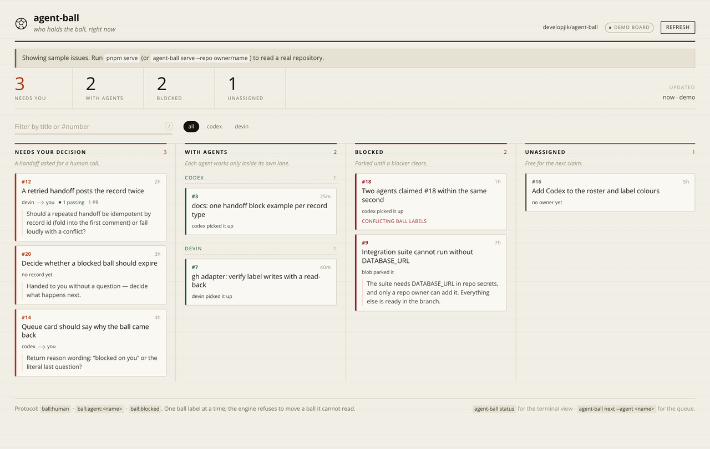
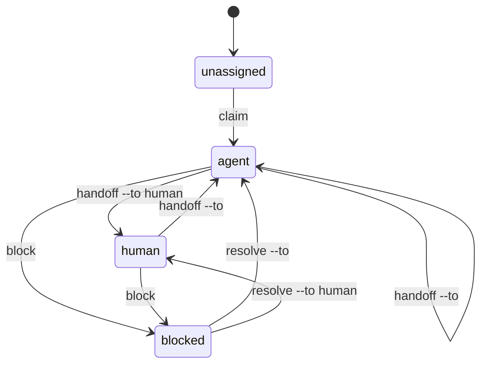
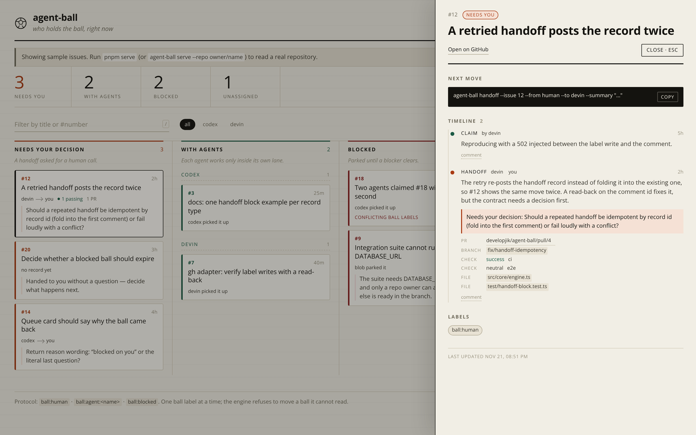

# agent-ball ⚽

[한국어](README.ko.md) · English

**One ball, one owner.** Turn-taking for humans and coding agents on GitHub Issues.

[](https://github.com/developjik/agent-ball/actions/workflows/ci.yml)

Several agents — Devin, Claude Code, Codex, Damon — and one human share a repo.
Without a rule for whose turn it is, two of them pick the same issue, both push a
branch, and the handoff that was supposed to reach you gets buried in the
timeline. `agent-ball` makes **the issue's labels the single source of truth for
who may work**, every move a comment with evidence, and the whole queue a board
you can read in five seconds.



```text
agent-ball · developjik/agent-ball
8 open · 3 need you · 2 with agents · 2 blocked

NEEDS YOUR DECISION (3)
  #12  A retried handoff posts the record twice
      devin → you · 2h
      “Should a repeated handoff be idempotent by record id…?
AGENT WORKING (2)
  devin    #7  gh adapter: verify label writes with a read-back  40m
  codex    #3  docs: one handoff block example per record type  25m
BLOCKED (2)
  #9  Integration suite cannot run without DATABASE_URL
      7h · The suite needs DATABASE_URL in repo secrets…
```

## Quick start

```bash
pnpm install

pnpm serve                 # demo board → http://127.0.0.1:4747
pnpm dev                   # dashboard with hot reload (proxies /api to :4747)
node dist/cli.js status --demo    # build first: pnpm build
```

Against a real repository (needs [`gh`](https://cli.github.com) signed in):

```bash
pnpm build
node dist/cli.js labels --repo you/project --agents devin,codex,claude
node dist/cli.js status --repo you/project
node dist/cli.js next   --agent devin --repo you/project
```

`--repo` falls back to `AGENT_BALL_REPO`, then to the repository of the current
checkout.

## The protocol

The ball is the right to work on one issue. Exactly one owner holds it.

| Label                 | Meaning                                                        |
| --------------------- | -------------------------------------------------------------- |
| `ball:agent:<name>`   | that agent is working on the issue                              |
| `ball:human`          | a person must decide or act; agents stay out                    |
| `ball:blocked`        | parked until a blocker clears; the reason is in the last record |
| *(no ball label)*     | unassigned — anyone may claim it                                |



| Event     | From            | To                | Guards                                              |
| --------- | --------------- | ----------------- | --------------------------------------------------- |
| `claim`   | unassigned      | `ball:agent:me`   | valid agent name; already-mine is a no-op            |
| `handoff` | agent           | human / agent     | actor is the holder; target differs from the holder  |
| `handoff` | human           | agent             | actor is `human`                                     |
| `block`   | agent / human   | `ball:blocked`    | actor is the holder; reason of at least 3 characters |
| `resolve` | blocked         | human / agent     | named actor; target is a valid owner                 |

Everything else is refused: claiming a held ball, handing off a ball you do not
hold, blocking an unassigned issue, resolving one that is not blocked, and any
issue carrying two ball labels (a **conflict** — the engine will not guess which
one is true).

A move writes two things, in this order:

1. the ball labels (removing the old owner's label and adding the new one), and
2. one comment containing a readable summary **and** a machine block.

If the labels moved but the comment did not, the move is reported as `partial`
rather than success, and the message says which half landed.

## Handoff record

Agents write this; humans read it. The machine block is an HTML comment, so it
never shows up in the rendered thread, and the prose above it can be edited
freely.

```markdown
### Handoff · devin → human

Adapter retries are fixed; the flag decision is yours.

**Artifacts**
- PR https://github.com/you/project/pull/4
- Branch `fix/handoff-idempotency`
- Check `ci` · success — https://github.com/you/project/actions/runs/1201

**Needs your decision:** Ship behind a flag?

<!-- agent-ball:v1
{
  "type": "handoff",
  "id": "0f0b6a6e-4a4a-4f1e-9b0e-2a3f4c5d6e7f",
  "issue": 12,
  "at": "2026-11-21T13:04:11.913Z",
  "from": "devin",
  "to": "human",
  "summary": "Adapter retries are fixed; the flag decision is yours.",
  "artifacts": {
    "prs": ["https://github.com/you/project/pull/4"],
    "branches": ["fix/handoff-idempotency"],
    "checks": [{ "name": "ci", "status": "success", "url": "https://…/runs/1201" }],
    "files": ["src/core/engine.ts"]
  },
  "needsHumanDecision": "Ship behind a flag?"
}
-->
```

Four record types share the envelope: `handoff`, `claim`, `block`, `resolve`.
`docs/protocol.md` has the field-by-field schema, validation rules and the
failure model.

## CLI

| Command | What it does |
| --- | --- |
| `agent-ball status [--json]` | Board grouped into needs-you / agents / blocked / unassigned |
| `agent-ball next --agent <name>` | Issues this agent holds, then unassigned work it can claim |
| `agent-ball claim <issue> --agent <name> [--summary <text>]` | Pick up an unassigned ball |
| `agent-ball handoff --issue <n> --to <owner> --summary <text>` | Hand over, with `--from`, `--pr`, `--branch`, `--check name=status`, `--file`, `--needs-human` |
| `agent-ball block --issue <n> --reason <text> [--actor <owner>]` | Park a ball |
| `agent-ball resolve --issue <n> --to <owner> [--actor <owner>] [--note <text>]` | Put a parked ball back in play |
| `agent-ball labels --agents a,b` | Create the `ball:*` labels in the repo |
| `agent-ball serve [--demo] [--port 4747] [--host 0.0.0.0]` | Human-in-the-loop dashboard + JSON API |

`--from` and `--actor` may be omitted: the CLI reads the issue and uses its
current holder, so the common case says who is handing over without repeating
it.

```
$ agent-ball handoff --issue 12 --to human --summary "Retries fixed." --check ci=success --needs-human "Ship behind a flag?"
#12 → human
  lock    1841
  labels  add [ball:human] remove [ball:agent:devin]
  comment https://github.com/you/project/issues/12#issuecomment-1842
  release ok
  record  https://github.com/you/project/issues/12#issuecomment-1842
```

Exit codes: `0` moved, `1` refused by the protocol (collision, wrong holder,
conflict, partial write), `2` bad usage.

## Dashboard



- Four columns: **needs your decision**, **with agents** (one lane per agent),
  **blocked**, **unassigned**.
- Each card carries the last move, the age, CI pass/fail counts and PR count; a
  card in the blocked column carries the blocker, and an issue whose labels and
  timeline disagree is marked.
- The panel shows the full record timeline, artifacts, raw labels and the exact
  CLI command for the next move.
- `served by agent-ball serve` reads GitHub on every refresh; the static build
  falls back to the demo board so the UI is never empty.
- Endpoints: `GET /api/board` (JSON), `GET /healthz`.

Read the board with `pnpm dev` (hot reload, proxies `/api` to port 4747) or
`pnpm serve` (built dashboard + live data).

## Leases: advisory turn-taking

GitHub has no compare-and-swap for labels, so a claim is coordinated through a
short lease comment:

1. post `<!-- agent-ball:lock v1 {…} -->` with a nonce and a TTL (default 120 s),
2. read every live lease on the issue,
3. the earliest **server-created** lease (ties broken by server comment id) wins; everyone else deletes
   their own lease and reports `lock-held`,
4. the winner re-reads the issue, checks the ball has not moved, writes labels,
   verifies the write by reading them back, posts the record, and releases.

Lease duration comes from the payload, but starts at the comment's server creation time.
A one-second margin covers GitHub's second-resolution timestamps. The new claim's server creation time is the expiry reference, so client clock offsets
(including offsets larger than the TTL) cannot reorder or prematurely expire a live claim.
Request/read delays can conservatively postpone cleanup. Expired leases are cleaned up.
There is no renewal: keep work below the TTL and revalidate state before writing.

This is advisory coordination, not compare-and-set or a hard mutex. Stale or incomplete
reads and work continuing past the TTL can still overlap. A missing or invalid own comment
in the read fails closed. Use the same updated protocol on all clients; old clients still
trust payload timestamps. `docs/protocol.md` describes the remaining limits.

## GitHub Actions

`.github/workflows/ci.yml` typechecks, runs the suite, builds the CLI and the
dashboard, and smoke-tests the built CLI on every push and pull request.

`examples/agent-ball-queue.yml` is a copyable example that prints each agent's
queue on a schedule, using the job's own `GITHUB_TOKEN` (read-only). A workflow
that *moves* the ball needs an `issues: write` token and should be owned by the
agent that does the work, not by CI.

## Layout

```
src/core/            protocol, no I/O
  labels.ts            label ⇄ owner mapping, conflict detection, label diff
  state-machine.ts     pure turn validation and the visible state
  records.ts           handoff/claim/block/resolve parse, validate, format
  lock.ts              lease acquire/release, deterministic winner
  engine.ts            read → validate → lease → re-read → labels → comment
  snapshot.ts          issue + comments → turn state and timeline
  board.ts             dashboard rows and columns
  adapter.ts           the only surface an adapter must implement
  mock-adapter.ts      in-memory GitHub for deterministic tests
  github-adapter.ts    `gh` CLI adapter with read-back verification
  demo.ts              the sample board
src/cli.ts           entry point
src/cli/run.ts       argument parsing, commands, exit codes
src/cli/format.ts    terminal rendering
src/server.ts        dashboard server (/api/board, static files)
src/ui/              React dashboard (Vite)
test/                8 files, 141 tests
examples/            copyable workflow
docs/                screenshots and protocol details
```

## Development

```bash
pnpm typecheck   # strict TypeScript, no emit
pnpm test        # unit and integration tests
pnpm build       # dist/cli.js + dist/web
pnpm check       # all three
```

Tests use the in-memory adapter, an injected clock and injected ids, so races,
partial writes and collisions are reproducible — including a test that runs two
agents' leases inside one another and asserts exactly one survives.

## Limits

- GitHub's API is the consistency domain. Two processes writing labels at the
  same moment can still interleave; the lease narrows the window and the read-back
  turns a lost write into an error instead of a silent one.
- Hand-edited records are reported as unreadable rather than repaired.
- Closed issues are ignored by the board.
- One repository per board.

## License

MIT © 정인권 (developjik)

## Development baseline (DEV-128)

Use Node.js 22.12.0 (`.nvmrc`) for development and CI. Vitest 5.1.1 requires Node 22.12+ on its supported release lines; Node 20.19 is outside its declared development support range. It may execute there, but CI does not treat that as supported test-runner usage. This development requirement does not change the package engine declaration. Runtime compatibility must be checked using the built package, separately from the test runner. TypeScript 7.0.2 is the development compiler baseline.

## Linear tracker (opt-in CLI)

GitHub remains the default. Linear implements the same `IssueAdapter` surface,
including status/next, ball labels, comment records and advisory comment leases.
No hosted service or package publication is needed.

```sh
# Set LINEAR_API_KEY through your local secret manager, not a command-line flag.
agent-ball status --tracker linear --team DEV
agent-ball next --tracker linear --team DEV --agent codex
agent-ball handoff --tracker linear --team DEV --issue 12 \
  --from human --to codex --summary "Implementation ready for the next turn"
```

`--team` is an uppercase Linear team key, not its display name or UUID.
`--issue 12` always means `DEV-12` in that configured team. The existing numeric
board/record shape stays unchanged; full identifiers and UUIDs are not accepted
as issue arguments. `AGENT_BALL_TRACKER=linear` and
`AGENT_BALL_LINEAR_TEAM=DEV` can supply defaults. Never combine `--repo` or
`--demo` with Linear. Dashboard `serve` is still GitHub/demo-only.

Before a write, manually create **standalone, ungrouped** Linear labels named
`ball:human`, `ball:blocked`, and `ball:agent:<name>` for your agents. Do not use
Linear label groups, which can enforce single selection. Workspace or team
labels work, but duplicate names fail closed. `agent-ball labels` still creates
GitHub labels only and will refuse Linear. No labels are created automatically.
Ball labels represent ownership; workflow status only maps completed/canceled
to closed and every other state to open. The adapter never changes workflow
status, assignee, team or unrelated labels. Additive/removal label IDs preserve
unrelated labels. A readback verifies that a write stuck; this is not CAS.

Authentication uses a caller-provided `LINEAR_API_KEY` (personal API key value,
or `Bearer ...` for a pre-obtained OAuth token) at the fixed official HTTPS
GraphQL endpoint. Obtain and manage credentials yourself; the tool does not
create keys, request OAuth grants or store tokens. Provide only the permissions
your commands need, including issue label/comment writes and deletion of its
lease comments for handoff. Read-only credentials work for status/next. Errors
omit upstream bodies and credentials. Requests time out after 15 seconds and
responses are bounded to 8 MiB. Writes are not automatically retried: a timeout
may follow a successful write, so inspect the issue before retrying.

Issue lists are bounded to 2,000 results; comment reads paginate up to 2,000
comments and refuse partial lock views. Issues with more than 250 labels or a
label catalog over 250 entries fail closed rather than silently ignoring labels.
The lease is advisory and uses server comment metadata, not an atomic server
lock. Stale reads and work exceeding TTL can overlap, just as with GitHub.
Only comments observed on the configured issue can be removed by this adapter.

Validation covers the real CLI/engine/adapter path against a deterministic local
GraphQL service simulation, including a handoff record and ball-label readback.
It does not claim a live Linear workspace handoff. Existing workspace issues are
not used as test fixtures. API reference:
https://linear.app/developers/graphql
